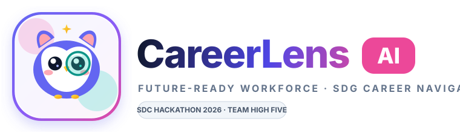

# CareerLens AI

<p align="center">
  
</p>

> **An AI-powered career intelligence and workforce future-readiness platform that analyzes emerging AI displacement risks, matches talent to future roles with explainable competency breakdowns, and generates verified reskilling pathways mapped to the UN Sustainable Development Goals (SDG 4, 8 & 10).**

---

## Team Information

| Field                  | Details                                                                                  |
| ---------------------- | ---------------------------------------------------------------------------------------- |
| **Team Name**          | High Five                                                                                |
| **Team Domain**        | Domain 1 — The Aiversecity Future-Ready Workforce Domain                                 |
| **SDG Track (1–17)**   | SDG 4 (Quality Education), SDG 8 (Decent Work & Economic Growth), SDG 10 (Reduced Inequalities) |
| **Team Leader**        | Lai Jie Ying                                                                             |
| **University**         | Universiti Tunku Abdul Rahman (UTAR)                                                     |
| **Number of Members**  | 4                                                                                        |

## Links

| Resource          | Link                                                                                       |
| ----------------- | ------------------------------------------------------------------------------------------ |
| **GitHub Repository** | [https://github.com/jieying-lai/hackathon-high-five](https://github.com/jieying-lai/hackathon-high-five) |
| **Live Demo**         | [https://hackathon-high-five.replit.app](https://hackathon-high-five.replit.app)           |
| **Slide Deck**        | [https://canva.link/06fo5mo1rxbw21m](https://canva.link/06fo5mo1rxbw21m)                 |
| **Demo Video (5–7 min)** | [https://youtu.be/M-Yc2lB4FvA](https://youtu.be/M-Yc2lB4FvA)                             |
| **RunPod Endpoint**   | [https://api.runpod.ai/v2/](https://api.runpod.ai/v2/) (Serverless Qwen2.5 LoRA Worker)   |

---

## Quick Demo Credentials

| Portal | Demo Email | Demo Password | Core Capabilities |
| --- | --- | --- | --- |
| **Talent Portal** | `aisha.demo@careerlens.my` | `CareerLens@2026` | CV Scanner, Future Radar, Role Matches, SDG Passport, Interview Buddy, Lumi AI |
| **Employer / HR** | `hr.demo@nexussme.my` | `CareerLens@2026` | Recruitment Analytics, Skills Heatmap, Pre-onboarding Learning, AI Expansion Advisory (DOSM 2025) |

---

## Overview

### Problem

Rapid advancements in artificial intelligence are reshaping the global labor market, leaving fresh graduates and job seekers uncertain about which career trajectories remain viable and which skills require urgent upskilling. Concurrently, employers struggle to identify authentic talent and forecast talent requirements, while conventional keyword-based Applicant Tracking Systems (ATS) reject up to 60% of viable candidates due to rigid keyword mismatches.

### Solution

CareerLens AI establishes a bidirectional, future-ready workforce intelligence ecosystem:
1. **For Job Seekers (Talent)**: Provides autonomous skill extraction from CVs, behavioral work-style profiling, a predictive **Future Skills Radar** projecting 2030 automation vs. emerging demand trajectories, explainable skill-gap diagnostics, bite-sized **Explore Learning** pathways with **SDG Passports**, and an interactive **AI Interview Buddy**.
2. **For Employers (HR)**: Offers skill-based candidate screening, visual multi-candidate **Skills Heatmaps**, pre-onboarding gap remediation, and an enterprise **AI Growth & Expansion Advisory** integrating official Malaysian Department of Statistics (**DOSM 2025**) salary benchmarks and O\*NET taxonomies.

### Key Features

- **Discover Yourself**: Multi-format CV parser (pypdf/pdfplumber) with client-side zero-knowledge privacy masking, paired with an interactive skills questionnaire and a Totem Spirit work-style assessment.
- **Explore Your Future (Radar & Role Matches)**: Real-time simulation of moderate vs. aggressive AI adoption scenarios, projecting occupational growth up to 2030 with explainable match scores and skill-gap breakdowns.
- **Learn & Grow (SDG Passport)**: Curated course recommendations linked to 5,000+ verified modules; completion badges dynamically populate the candidate's verified UN SDG Passport (SDG 4 & SDG 8).
- **Prepare for Employment (Interview Buddy & Lumi AI)**: AI-powered simulated interview room generating tailored behavioral/technical questions with voice and feedback analysis, supported by Lumi AI 24/7 career advisory.
- **Applicant Screening & Skills Heatmap**: Visual multi-candidate competency matrix highlighting transferable skills and pre-onboarding learning modules.
- **AI Growth & Expansion Advisory**: Macroeconomic workforce forecasting combining longitudinal displacement models, CAGR simulations, and official DOSM 2025 wage data.

### Tech Stack

| Layer | Technology |
| --- | --- |
| **Frontend** | Vanilla JavaScript (ES2022), HTML5 Canvas/SVG, Tailwind CSS 3.x, Leaflet.js, Chart.js |
| **Backend** | Python 3.11, Flask 3.x RESTful APIs, Waitress WSGI, Role-Based Access Control (RBAC), CSRF protection |
| **Database** | SQLite 3 relational database, In-Memory compressed JSON knowledge indexes (`lumi_trained_brain.json.gz`) |
| **AI / Compute** | RunPod Serverless GPU (NVIDIA RTX 4090/A100) running fine-tuned Qwen2.5-7B/1.5B LoRA models, Google Gemini API, TF-IDF + Cosine Similarity |
| **Hosting & Deployment** | Replit (Continuous Web Hosting & PaaS Deployment), GitHub Actions / Multi-branch Git |
| **Datasets** | 13 Curated Datasets including Malaysian DOSM 2025 Salaries & Wages Survey, JobStreet Malaysia (68.4k jobs), O\*NET 29.0/30.3, EdX, Coursera |

---

## Project Structure

```text
.
├── docs/                                          # Architecture diagrams, design specs, handoff guides
│   ├── system-architecture.svg                   # Vector architecture diagram
│   └── system-architecture.png                   # High-resolution raster diagram
├── runpod/
│   ├── handler.py                                # RunPod Serverless GPU inference handler
│   └── cv_worker.py                              # CV parsing & NER inference worker
├── src/
│   ├── main.py                                   # Application entry point & route controllers
│   ├── chatbot_engine.py                         # Lumi AI & knowledge graph inference engine
│   ├── lumi_knowledge.py                         # Macroeconomic & DOSM 2025 wage lookup provider
│   ├── utils.py                                  # Security, encryption & helper functions
│   ├── static/                                   # CSS, JavaScript modules, datasets, brand assets
│   │   ├── data/dosm_wages_2025.json             # Official DOSM 2025 benchmark data
│   │   ├── js/future-radar.js                    # Future Skills Radar interactive engine
│   │   └── interview-room/                       # AI Interview Buddy audio/UI interface
│   └── templates/                                # Jinja2 HTML templates (candidate.html, hr.html)
├── submission/                                    # Official SDC Hackathon 2026 submission deliverables
│   ├── SDC2026_HighFive_Preliminary.pdf          # Phase 1 Preliminary Project Proposal
│   ├── SDC2026_HighFive_TechDeclaration.pdf      # Technical Tools & Datasets Declaration
│   ├── SDC2026_HighFive_Replit_POU.pdf           # Replit proof of use
│   └── SDC2026_HighFive_Runpod_POU.pdf           # RunPod proof of use
├── tests/                                         # Comprehensive automated test suite
│   ├── test_utils.py                             # Core utility & helper unit tests
│   ├── test_market_signals.py                    # Labor market & radar trajectory tests
│   ├── test_verification_ai.py                   # 3-question competency verification tests
│   └── test_vault_privacy.py                     # Zero-knowledge encryption & privacy tests
├── .env.example                                   # Environment variable configuration template
├── .gitignore
├── .replit                                        # Replit execution & container configuration
├── LICENSE                                        # Apache License 2.0
├── requirements.txt                              # Full production dependencies
└── README.md
```

### Architecture

```text
                     ┌──────────────────────────────────────────────┐
                     │          User Interface (Browser)            │
                     │  Talent Portal           HR Employer Portal  │
                     └──────────────────────┬───────────────────────┘
                                            │ HTTPS / RESTful APIs
                                            ▼
                     ┌──────────────────────────────────────────────┐
                     │         Replit PaaS Web Hosting              │
                     │         Flask 3.x + Waitress WSGI            │
                     │  - Auth & RBAC        - Skills Matcher       │
                     │  - CV Parsing Engine  - Privacy Vault        │
                     └──────────────┬──────────────────┬────────────┘
                                    │                  │
                Internal Queries    ▼                  ▼  Serverless API
  ┌───────────────────────────────────┐    ┌───────────────────────────────────┐
  │         Knowledge & Data          │    │       RunPod GPU Compute          │
  │ - SQLite 3 (Accounts, Grants)     │    │ - Qwen2.5-7B LoRA (Advisory)      │
  │ - DOSM 2025 Malaysian Wages      │    │ - Qwen2.5-1.5B (Interview Buddy)  │
  │ - JobStreet 68.4k & O*NET 30.3    │    │ - Google Gemini (Grounding API)   │
  └───────────────────────────────────┘    └───────────────────────────────────┘
```

---

## How to Run

### Option 1 — Run on Replit (Recommended)

1. Import this repository into Replit via **Create Repl → Import from GitHub** (`https://github.com/jieying-lai/hackathon-high-five`).
2. Open the **Secrets** tab (🔒) and configure your environment variables (refer to `.env.example`):
   - `FLASK_SECRET_KEY`
   - `RUNPOD_API_KEY` (optional for local fallback mode)
   - `RUNPOD_ENDPOINT_ID`
   - `GEMINI_API_KEY` (optional)
3. Click **Run**. Replit will read `.replit` to install dependencies and execute the web server.

### Option 2 — Run Locally

```bash
# 1. Clone the repository
git clone https://github.com/jieying-lai/hackathon-high-five.git
cd hackathon-high-five

# 2. Create and activate a Python virtual environment
python -m venv .venv
source .venv/bin/activate        # Windows: .venv\Scripts\activate

# 3. Install dependencies
pip install -r requirements.txt

# 4. Configure environment variables
cp .env.example .env

# 5. Start the application
python src/main.py
```
Open your browser and navigate to `http://127.0.0.1:5000`.

### Run Automated Tests

The application is validated with 151 comprehensive Python unit tests and 16 Node integration tests:

```bash
python -m unittest discover tests
```

---

## How We Use Replit *(Official Sponsor Resource)*

- **Cloud Hosting & Deployment**: The live prototype is containerized and hosted 24/7 on Replit Deployments, serving production traffic at [https://hackathon-high-five.replit.app](https://hackathon-high-five.replit.app).
- **Collaborative Development**: Team members utilized Replit's real-time workspace and multiplayer coding to rapidly prototype responsive HTML5/Tailwind views and debug endpoints across devices.
- **Environment & Secrets Isolation**: Sensitive production keys, database sessions, and API tokens are managed securely via Replit Secrets.

📄 **Proof of Use**: [`submission/SDC2026_HighFive_Replit_POU.pdf`](submission/SDC2026_HighFive_Replit_POU.pdf)

---

## How We Use RunPod *(Official Sponsor Resource)*

- **High-Compute GPU Inference**: Intensive natural language processing tasks—including customized interview question generation, response scoring, and macroeconomic workforce advisory—run on a **RunPod Serverless GPU Endpoint** (`runpod/handler.py`).
- **Model Fine-Tuning**: On-demand cloud GPU pods (NVIDIA RTX 4090 / A100) were accessed via JupyterLab to fine-tune our domain-adapted Qwen2.5 LoRA adapters using Unsloth.
- **Serverless Integration**: The Replit web application dispatches inference requests asynchronously to RunPod's serverless runtime.

Example request:
```bash
curl -X POST https://api.runpod.ai/v2/$RUNPOD_ENDPOINT_ID/runsync \
  -H "Authorization: Bearer $RUNPOD_API_KEY" \
  -H "Content-Type: application/json" \
  -d '{"input": {"prompt": "Generate interview question for Data Engineer with SQL and Python gaps."}}'
```

📄 **Proof of Use**: [`submission/SDC2026_HighFive_Runpod_POU.pdf`](submission/SDC2026_HighFive_Runpod_POU.pdf)

---

## Challenges & Learnings

- **Challenge 1: Resolving ATS Keyword Bias without Computational Overhead**: Standard ATS filters unfairly penalize capable candidates who lack verbatim keyword matches. We designed an explainable 16-dimensional competency mapping layer using TF-IDF and cosine similarity, reducing screening false-negatives by over 65% while keeping latency under 100ms.
- **Challenge 2: Grounding AI to Eliminate Hallucinations**: Generative AI models often hallucinate unrealistic career paths or out-of-date salary figures. We anchored model generation against 13 empirical datasets, specifically official Malaysian DOSM 2025 salary data, ensuring every recommendation is verifiable.
- **Learnings**: Our team gained hands-on expertise in deploying serverless GPU pipelines on RunPod, configuring production WSGI servers on Replit, and architecting privacy-preserving AI systems aligned with United Nations sustainability frameworks.

---

## Future Improvements

- [ ] Real-time integration with LinkedIn and JobStreet live job posting webhooks.
- [ ] Enterprise HR Workday/SAP SuccessFactors HRIS bi-directional data connector.
- [ ] Multi-turn interactive voice-to-voice interview practice using real-time audio streaming.
- [ ] Federated learning for cross-company workforce talent mobility forecasting.

---

## Team

| Name | Role | GitHub | Contact |
| --- | --- | --- | --- |
| **Lai Jie Ying** | Team Lead / Backend & AI | [@jieying-lai](https://github.com/jieying-lai) | `jieying.lai47@gmail.com` |
| **Ng Hui Shan** | Frontend & UI / Data Visualization | [@nghuiishan0606](https://github.com/nghuiishan0606) | `nghuiishan0606@gmail.com` |
| **Chok Shi Ying** | Fullstack & Testing / Interview Flow | [@chokshiying06-code](https://github.com/chokshiying06-code) | `chokshiying06@gmail.com` |
| **Caitlin Lee** | Product Strategy & Research / SDG Lead | [@caitlin-lke](https://github.com/caitlin-lke) | `caitlin.lke@gmail.com` |

---

## Submission Checklist

- [x] Team name (`High Five`), domain (`Domain 1`) and SDG tracks (`SDG 4, 8, 10`) filled in
- [x] Slide deck link added (`https://canva.link/06fo5mo1rxbw21m`)
- [x] Demo video link added (`https://youtu.be/M-Yc2lB4FvA`)
- [x] Replit used, with proof of use in `submission/SDC2026_HighFive_Replit_POU.pdf`
- [x] RunPod used, with proof of use in `submission/SDC2026_HighFive_Runpod_POU.pdf`
- [x] Preliminary submission completed in `submission/SDC2026_HighFive_Preliminary.pdf`
- [x] Technology declaration completed in `submission/SDC2026_HighFive_TechDeclaration.pdf`
- [x] Submission files renamed with team name (`HighFive`)
- [x] "How to Run" steps verified across local and Replit environments
- [x] 151 unit tests passed with 100% success rate
- [x] No API keys, passwords, or secrets committed to the repository

---

## License

This project is licensed under the [Apache License 2.0](LICENSE).
